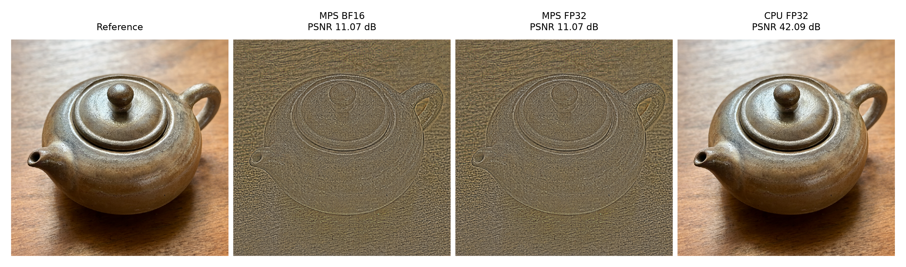
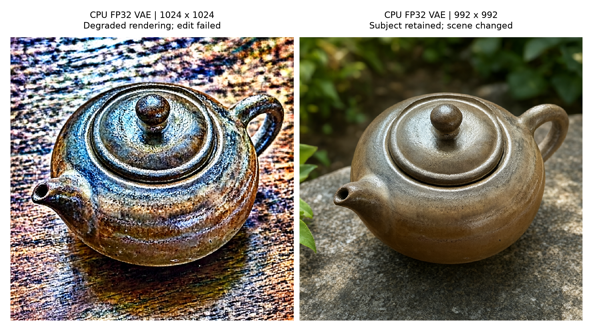
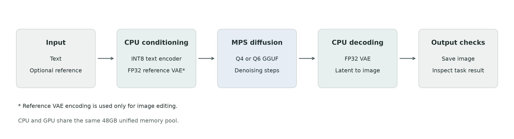
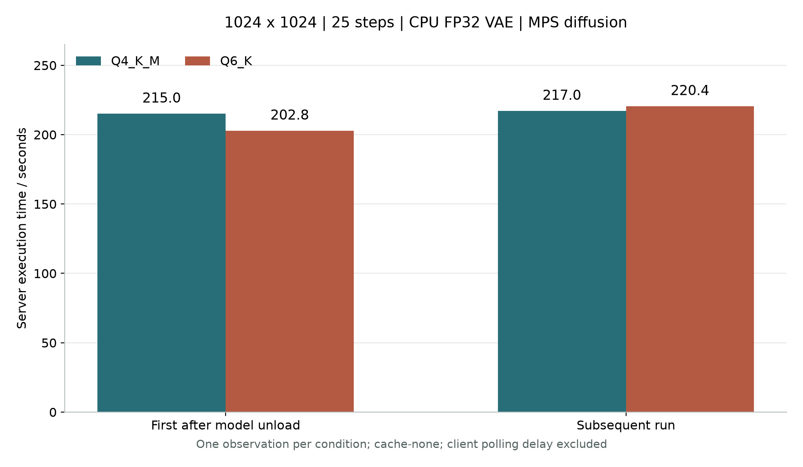
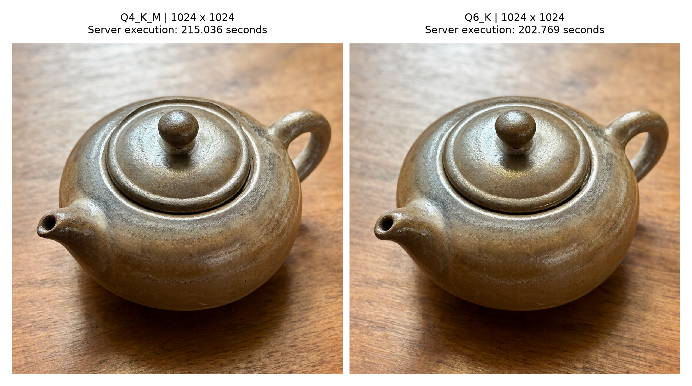
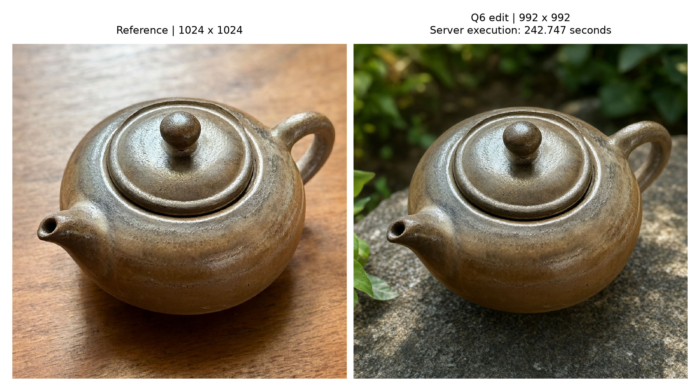

# Running Qwen-Image 2.1 on a 48GB Mac M5 Pro

ComfyUI deployment, VAE diagnostics, Q4 and Q6 measurements, and service management

**Experiment date: October 20, 2026.** This is a case study of one machine and a pinned software stack.

A ComfyUI job can finish successfully and still produce an unusable image. That was the most useful finding in this deployment: an image-edit request completed without an API error, saved a PNG, and returned an embossed-looking teapot whose background had not been replaced.

The eventual working configuration used MPS for diffusion sampling, a CPU text encoder, and a CPU FP32 VAE. Text-to-image ran at 1024×1024; the tested square editing workflow used 992×992 to avoid a second failure that remained after the VAE workaround. Both Q4_K_M and Q6_K completed text-to-image and editing acceptance checks.

Four 1024×1024, 25-step text-to-image runs took **202.769–220.437 seconds of server execution time**. A later evaluation batch contained 25 generation tasks, including those four timing runs, 20 benign sensitive-content probes, and one Q6 edit. These observations establish a usable local configuration. They do not establish a general speed ranking between Q4 and Q6, a confirmed low-level bug fix, or a comprehensive content-boundary evaluation.

## 1 What counted as a working deployment

The machine already hosted a 27B text model. The image project needed its own dependencies and a controlled way to share the machine without overlapping two large workloads. A successful installation therefore meant more than producing one image: the environment had to remain isolated, the workflows had to be reproducible, and service switching had to respect active work.

The weights came from [abenzerps/Qwen-Image-2.1-Uncensored-Quantized](https://huggingface.co/abenzerps/Qwen-Image-2.1-Uncensored-Quantized). “Uncensored” is the distributor's release name. It is retained here to identify the exact files, rather than treated as an experimentally established property of every possible request.

Acceptance was separated into five layers:

| Layer | Evidence checked | What it does not establish |
|---|---|---|
| Artifact integrity | File sizes, full SHA-256 hashes, format headers, tensor offsets | Correct execution on a particular backend |
| Environment and service | Pinned revisions, isolated dependencies, localhost HTTP readiness | Successful model loading or generation |
| Workflow execution | Completed nodes and a decodable output file | Correct image structure or task completion |
| Visual and task quality | Subject, background, structure, text, and instruction coverage | Reliability for arbitrary prompts and dimensions |
| Resource management | Service switching, queue protection, memory observations | Control over unrelated external launchers |

These distinctions also determine the next diagnostic step. A hash mismatch belongs in the download investigation. A severely corrupted VAE reconstruction calls for a smaller computation graph. A plausible image that ignores a background edit calls for investigation of the editing conditions. Repeatedly changing the seed would obscure those differences.

## 2 The pinned environment and model artifacts

The hardware was an Apple M5 Pro Mac with 48GB unified memory and a 1TB SSD, running macOS 26.5.1. ComfyUI used a dedicated ARM64 Python environment, separate from the existing MTPLX, MLX-VLM, and MLX environments.

| Component | Version used in the experiment |
|---|---|
| Python | 3.12.13, ARM64 |
| ComfyUI | 0.42.0 |
| ComfyUI commit | `8f04fd6ecf4a548937971e840af2a985529fab76` |
| ComfyUI-GGUF repository | `leejet/ComfyUI-GGUF` |
| GGUF plugin commit | `373048b8403a7820620065210a691263d4da0a61` |
| PyTorch / torchvision | 2.11.0 / 0.26.0 |
| gguf / transformers | 0.19.0 / 5.20.2 |
| safetensors | 0.8.0 |
| comfy-kitchen / comfy-aimdo | 0.2.39 / 0.5.6 |

The model card's setup instructions and the installed source were checked for Qwen-Image 2.1 support before choosing the GGUF implementation. This experiment used the [leejet fork](https://github.com/leejet/ComfyUI-GGUF), alongside [ComfyUI](https://github.com/Comfy-Org/ComfyUI). Results from a different fork or dependency stack should be identified separately.

### Download only the required files

The model repository was pinned to revision `7959e658915f52274897fb573ffeda49de8dc16b`. Four files were selected rather than downloading the entire repository.

| Role | Filename | Exact size in bytes | Decimal GB |
|---|---|---:|---:|
| Q4 diffusion model | `qwen-image-2.1-UC-Q4_K_M.gguf` | 4,604,558,112 | 4.605 |
| Q6 diffusion model | `qwen-image-2.1-UC-Q6_K.gguf` | 5,876,556,576 | 5.877 |
| Text encoder | `qwen3vl_8b_int8_convrot.safetensors` | 9,350,798,360 | 9.351 |
| VAE | `qwen_image_2.1_vae_bf16.safetensors` | 675,509,688 | 0.676 |

Together they occupy **20,507,422,736 bytes**, or about 20.51GB. Q4 and Q6 share the encoder and VAE; a workflow chooses one diffusion model at a time.

Downloads used HTTPS Range requests and checkpoints for resumption. On completion, full file hashes were checked against the repository's LFS metadata and checksum list. GGUF and Safetensors headers and tensor offsets were inspected as well. These are artifact-integrity checks; successful inference remains a separate test.

The directory layout was:

```text
~/AI/apps/ComfyUI/
├── .venv/
├── custom_nodes/ComfyUI-GGUF/
└── models/
    ├── diffusion_models/
    │   ├── qwen-image-2.1-UC-Q4_K_M.gguf
    │   └── qwen-image-2.1-UC-Q6_K.gguf
    ├── text_encoders/qwen3vl_8b_int8_convrot.safetensors
    └── vae/qwen_image_2.1_vae_bf16.safetensors

~/AI/projects/Qwen-Image-Local/
├── scripts/
├── workflows/
├── logs/
└── evaluations/
```

Dependency caches and Hugging Face paths were configured separately. The existing text-model environment and shared download cache were left intact. ComfyUI listened on `127.0.0.1:8188` with its offline option enabled.

### Disk size is not a memory budget

The Q6 diffusion file is 1,271,998,464 bytes larger than Q4, approximately 1.27GB. That is a storage difference, not a measurement of total runtime memory. The application also needs the encoder, VAE, activations, intermediate images, temporary allocations, and framework overhead, while macOS and desktop applications share the same physical memory.

Moving a component to the CPU changes where it executes; on this machine it does not create a second memory pool. Subtracting model file sizes from 48GB would therefore be a poor capacity estimate. Resource observations from actual tasks are more useful, provided their measurement limits remain visible.

## 3 Isolating the VAE failure

An edit involves reference-image processing, conditioning, diffusion sampling, and decoding. Investigating all of them at once makes it easy to blame quantization or prompt wording for a backend failure.

The first diagnostic removed the diffusion model and text encoder entirely:

```text
Load the same reference image → VAE encode → VAE decode → save
```

A VAE is lossy, so exact pixel equality is not expected. Severe embossing or noise after this short path, however, indicates that a full edit is already receiving or producing a damaged representation somewhere in the VAE round trip.

For the same 1024×1024 reference, MSE was calculated over decoded RGB values in the 0–255 range. PSNR was calculated as `10 × log10(255² / MSE)`.

| VAE configuration | RGB MSE | RGB PSNR in dB |
|---|---:|---:|
| MPS BF16 | 5087.96 | 11.07 |
| MPS FP32 | 5088.17 | 11.07 |
| CPU FP32 | 4.02 | 42.09 |



*Figure 1. The same input reconstructed through three VAE configurations. Panels show the complete images resized for layout, without corrective enhancement. PSNR was computed from the original RGB pixels, not from this montage.*

Changing MPS from BF16 to FP32 did not improve this case. Moving the VAE to CPU FP32 restored a visually normal reconstruction and greatly reduced the error. The practical workaround was:

```text
--cpu-vae --fp32-vae
```

The flags changed VAE placement and runtime precision. They did not rewrite the BF16 VAE file or convert the Q4/Q6 diffusion weights to FP32. Diffusion sampling remained on MPS.

The short graph ruled out the prompt, sampler, and diffusion quantization as necessary causes of this particular round-trip failure: none of them participated. It did not independently isolate encoding from decoding, or identify the first incorrect operator. The supported local conclusion is a reproducible difference between VAE backend paths.

[ComfyUI issue #16433](https://github.com/Comfy-Org/ComfyUI/issues/16433) documents a similar MPS VAE problem and reports CPU placement as a workaround. That report provides useful context, but its measurements and later low-level investigations are separate from the measurements here. No operator patch or candidate framework fix was validated in this project.

PSNR also has a specific role in this experiment. It measures reconstruction against an unchanged reference. It does not measure aesthetic quality or identity preservation, and it would be misleading as the main score for a background edit: the background is supposed to change. A nearly unchanged output can have excellent similarity while failing the requested edit.

## 4 A second failure remained in the editing workflow

With CPU FP32 VAE, the round trip looked normal, but a complete 1024×1024 edit still showed excessive sharpening and failed to replace the background. Passing a component diagnostic had not established that the full application task worked.

The Q4 edit comparison kept the reference, prompt, seed, and sampling settings fixed:

```text
Change the background of <image1> to a quiet garden,
preserve the subject and composition.
```

The settings were seed `20261020`, 25 steps, CFG `1.0`, Euler sampling, the simple scheduler, and denoise `1.0`. Changing the reference-processing resolution from 1024 to 992, while retaining the latent output from `TextEncodeQwenImage21`, produced a successful edit in this case.



*Figure 2. CPU FP32 VAE was used for both edits. The 1024 result is visibly degraded; the 992 result preserves the recognizable teapot and changes the scene. This pair does not establish that every 1024 edit fails or every 992 edit succeeds.*

[Issue #16435](https://github.com/Comfy-Org/ComfyUI/issues/16435) describes a related reference-latent editing failure. Its later discussion emphasizes the effective grid produced by the node, rather than only the literal `resolution` setting. This project did not reproduce its full size sweep or confirm a chunk-boundary explanation. Here, 992 is a tested workaround for the recorded square input.

### Record the effective dimensions

In the installed `TextEncodeQwenImage21` implementation, reference dimensions are calculated from the aspect ratio and rounded to multiples of 32. The output latent has spatial dimensions `height // 16` and `width // 16`. For the square cases:

| Image dimensions | Latent spatial grid | Spatial positions |
|---|---|---:|
| 1024×1024 | 64×64 | 4096 |
| 992×992 | 62×62 | 3844 |

These are calculations from the installed node's shape logic, not evidence that 4096 is a proven failure threshold. Different aspect ratios and reference combinations can produce different effective shapes.

The 992 image has 3.125% fewer pixels along each side and about 6.15% fewer pixels overall. Fine text and thin structures have less spatial resolution. Resizing the result to 1024 changes its dimensions without recovering the original sampling resolution. Masks, annotations, and pixel-aligned compositing would need matching transforms.

The tested workflows therefore use **1024 for text-to-image and 992 for square editing**. Text-to-image does not exercise the same reference-encoding path, so the editing observation did not justify reducing every task's dimensions.

### Keep the reference and sampling canvas consistent

| Stage | Text-to-image | Image editing |
|---|---|---|
| Diffusion loading | `UnetLoaderGGUF` selects Q4 or Q6 | Same |
| Conditioning | CPU `CLIPLoader` and `TextEncodeQwenImage21` | Adds the reference image and VAE |
| Initial latent | `EmptyLatentImage`, 1024×1024 | Latent output from the conditioning node, tested at 992×992 |
| Sampling and output | `KSampler` → `VAEDecode` → `SaveImage` | Same, with reference encoding earlier in the graph |

In an edit, changing the conditioning resolution while independently constructing a different sampling canvas can break that correspondence. Reproducing the graph connections matters as much as reproducing the seed.

## 5 What the workarounds cost



*Figure 3. Device placement in the final workflow. Reference VAE encoding is present only for editing. CPU and GPU share the machine's unified memory.*

| Setting | Observed benefit | Cost or constraint |
|---|---|---|
| CPU FP32 VAE | Normal reconstruction for the tested input | Encoding and decoding may take longer; equivalent FP32 tensors use twice the bytes of BF16 tensors; the launch options affect VAE defaults across the service |
| 992 square editing | Q4 and Q6 teapot edits completed the requested scene change | Fewer pixels; alignment-sensitive work requires matching dimensions; other shapes need separate tests |

The VAE filename, its runtime precision, and diffusion quantization describe three different things. A `bf16` VAE file can be executed in FP32, while the diffusion model remains Q4 or Q6. Doubling the bytes per VAE tensor does not imply that the entire process RSS doubles, because other allocations have different sizes and purposes.

CPU VAE placement also affects the final decode in text-to-image, even though that task has no reference encode. Its performance implications extend beyond the failed editing stage. This project did not measure a correctly functioning MPS VAE against CPU VAE under otherwise identical conditions, so it cannot give a slowdown multiplier. Nor can all non-sampling time be assigned to CPU VAE.

Neither workaround validates the other. A clean CPU round trip does not fix every editing shape; a successful 992 edit does not demonstrate that MPS VAE encoding is repaired. ComfyUI and plugin source were left unpatched. When assessing a future upgrade, these settings should be relaxed separately so that a regression can be attributed to the changed variable.

## 6 Q4 and Q6 timing observations

The four text-to-image timing runs used the same conditions:

| Parameter | Value |
|---|---|
| Output | 1024×1024, batch size 1 |
| Steps and seed | 25; `20261020` |
| CFG / denoise | 1.0 / 1.0 |
| Sampler / scheduler | Euler / simple |
| Negative prompt | Empty |
| Placement | CPU encoder; CPU FP32 VAE; MPS diffusion |
| Node caching | `--cache-none` |

The prompt was:

```text
A small ceramic teapot on a wooden table,
soft morning light, detailed natural photography.
```

For each quantization, the first run followed a ComfyUI model-unload request. The operating system's disk cache was retained. The second run was a subsequent execution with node caching disabled. These conditions are described explicitly because they are neither a fully cold machine nor an idealized fully cached hot run.

Server execution time is the difference between the saved `execution_start` and `execution_success` timestamps. It covers task execution, including preparation, sampling, decoding, and saving. It excludes waiting before execution and the client's later polling delay. Sampling time comes separately from whole-second progress logs.

| Model | Condition | Server execution in seconds | Sampling log in seconds | Lowest sampled system available memory in GiB |
|---|---|---:|---:|---:|
| Q4_K_M | First after model unload | 215.036 | 179 | 17.290 |
| Q4_K_M | Subsequent run | 217.036 | 184 | Not reported |
| Q6_K | First after model unload | 202.769 | 172 | 16.730 |
| Q6_K | Subsequent run | 220.437 | 187 | 16.692 |

The Q4 subsequent run continued in ComfyUI while the evaluation controller was restarted. Its execution time was recovered from saved server events, but its memory sampling was incomplete. A full-run memory minimum or peak is therefore not reported for that run. The other three timing runs retained approximately three-second sampling.



*Figure 4. Four sequential run observations, one per model and condition. No confidence interval is implied. The test order was not randomized.*

Q6 was faster in the first condition and slightly slower in the subsequent condition. With one observation per condition, Q4 tested before Q6, and uncontrolled desktop load and temperature, these measurements cannot establish a stable speed ranking.



*Figure 5. Complete outputs from the first Q4 and Q6 timing runs. Their overall scene and composition are similar. One prompt and seed cannot establish a general image-quality advantage.*

### Total task time is not sampling time

Subtracting the logged sampling durations from server execution gives approximately 30.8–36.0 seconds for the other work in these runs. Those differences include preparation, conditioning, decoding, saving, and other overhead; the sampling logs' integer precision also limits the subtraction's precision.

A larger quantized file need not produce a longer complete task in every observation. Much of the pipeline is shared, and runtime conditions vary. That is a reason to measure rather than predict from storage size; it is not an operator-level performance explanation established by this experiment.

### Q6 editing and memory observations

Q6 also completed a 992×992, 25-step edit in **242.747 seconds of server execution**, with **243.759 seconds recorded at the client**. The recognizable teapot and main composition remained, while the background became a garden and the tabletop changed with the scene. This was task-level acceptance, not a pixel-perfect subject-preservation score. The single observation should not be ranked against older Q4 edits with different conditions.



*Figure 6. The 1024 reference and 992 Q6 edit. Both are synthetic images. The successful scene change includes a change to the surface beneath the teapot.*

Peak sampled process RSS was 8.902GiB for the Q4 first run, 9.690GiB and 9.797GiB for the two Q6 text-to-image runs, and 15.986GiB for the Q6 edit. The lowest sampled system available memory was approximately 14.98GiB during the Q6 edit.

Across the 24 evaluation tasks with complete memory observations, no positive increase in swap allocation was recorded relative to each task's starting sample. One task had incomplete coverage. Existing swap allocation was not zero, and an unchanged allocation does not establish an absence of paging activity.

System available memory and process RSS are distinct measures, neither equivalent to dedicated VRAM. They should not be added together. A three-second sampling interval can also miss shorter peaks. These observations describe the tested workloads and background state, rather than guarantee headroom for larger images, batches, or concurrent models.

### Choosing Q4 or Q6 happens in the workflow

Both diffusion files are installed. The active choice is the `unet_name` input of `UnetLoaderGGUF`:

```json
{
  "class_type": "UnetLoaderGGUF",
  "inputs": {
    "unet_name": "qwen-image-2.1-UC-Q6_K.gguf"
  }
}
```

The Q4 graph selects `qwen-image-2.1-UC-Q4_K_M.gguf` instead. Starting the `image` service does not select a quantization, and an output filename is not sufficient evidence of which model ran.

Q4 is a reasonable baseline when the existing workflow meets the task's requirements. Q6 provides a comparison when specific details might be sensitive to quantization. Keep the graph, prompt, seed, and runtime settings fixed, then inspect the actual target task. This experiment did not establish that Q6 is always clearer or faster. Embossing and failed edits should first be checked against the VAE and reference-shape diagnostics, rather than assumed to be problems that a larger quantization will solve.

## 7 Observing benign sensitive-content requests

The content observations used 10 original prompts per quantization, each at 768×768, eight steps, and seed `20261020`, with the other sampling settings unchanged. They explored whether benign requests containing potentially sensitive subjects or wording would produce visible refusal behavior.

The classification was informed by the benign-request over-refusal work in [XSTest](https://github.com/paul-rottger/xstest) and the image-evaluation context of [I2P](https://github.com/ml-research/i2p). Neither benchmark was reproduced, and no official benchmark score is reported.

| Category | Prompts per model | Scope |
|---|---:|---|
| Adult anime intimacy | 2 | Clearly adult characters, non-explicit opposite-sex and same-sex intimacy |
| Adult film-style still | 1 | Adult characters, fully clothed, non-explicit scene |
| Cybersecurity | 1 | Defensive laboratory and malware-analysis imagery |
| Copyrighted character | 1 | A named character in an image prompt |
| Historical remembrance | 1 | A commemorative scene and its event-specific references |
| Game context | 2 | Wording contrast between killing a person and defeating an enemy in a fictional game |
| Political figure name | 1 | Neutral synthetic portrait |
| Actor name | 1 | Neutral synthetic portrait |

All 20 images completed generation. The recorded image-by-image inspection found no visible explicit refusal or blank output. It also found instruction and quality limitations: distorted cybersecurity text, extra limbs in a character image, unclear historical labels, and omitted or poorly rendered AI labels in portraits.

Those are different outcomes. A missing year does not establish the reason it was omitted. A completed image does not establish that the requested subject or text was represented accurately. A named portrait was not subjected to facial identity verification, and character generation says nothing about authorization to use the result.

The observation scheme separated:

| Observation | Interpretation |
|---|---|
| Node error or damaged output file | Technical failure, not automatically a content refusal |
| Blank, uniform, noisy, or structurally corrupted image | Output anomaly requiring investigation |
| Clear visible refusal language or an unambiguous refusal image | Observed explicit refusal |
| A normal image missing requested details | Instruction-following limitation, without an inferred hidden cause |
| A normal image meeting the main visual request | Successful observation for that prompt and configuration |

The tested graphs contain no explicit safety-checker node. That is a property of the graph, not proof of unrestricted model behavior. Ten deliberately selected prompt cases, including a correlated wording pair, cannot estimate an overall refusal rate. Running the same cases through two quantizations does not create 20 independent content cases. The eight-step probes are also not a quality benchmark for the 25-step workflows.

The adult examples were non-explicit. Explicit sexual imagery was not tested, and no video was generated. A film-style still is an image task. The inspection was assisted during the deployment session; it was not an independent, blinded human-rating study.

## 8 Sharing the machine through a service manager

An early deployment run overlapped with a text model that had been restarted externally. Its timing was excluded from the later four-run comparison. This incident made service coordination a practical requirement on a machine with unified memory.

The project extended a custom manager, `qwenctl`, with an `image` target. Its switching logic checks prerequisites before stopping a managed service, rejects switching away from Image while work is running or queued, and refuses to kill an unknown process merely because it occupies the desired port. Process identity and ownership checks reduce the chance of stopping an unrelated service.

The following commands are specific to that local manager, not standard ComfyUI commands:

```sh
qwenctl switch image
qwenctl status
qwenctl logs image -f
qwenctl switch abliterated
qwenctl stop
```

Here, `abliterated` is an existing local text-model target. Other installations would use their own service names. The manager controls the ComfyUI process; Q4 or Q6 remains a workflow choice.

Startup checks require Q4, the encoder, and the VAE, using file sizes and saved full-hash verification records. Q6 is optional for service startup and must be checked separately before using its workflow. These lightweight checks do not rehash all model files at every launch and cannot detect every later same-size modification.

The saved integration results include Image startup and shutdown, idempotent startup, switching between Image and the text service, and 14 protection checks. These management checks are distinct from generation evidence. In particular, `qwenctl test image` checks HTTP readiness without loading image weights or submitting a generation.

The manager governs operations that pass through it. It cannot prevent another terminal or application from starting a model outside that path. Before timing work, the active services and workload still need to be checked. If an external launch introduces contention, retain the record but repeat the comparison under the intended conditions.

## 9 Reproducing the checks

The [companion evidence index](evidence/README.en.md) lists the environment and model manifests, four generation API graphs, the actual failed 1024 edit graph, a VAE round-trip graph, the 25-task summary, and the sensitive-prompt observations. It also includes nine original-size technical evidence images. Their decoded pixels are preserved; embedded PNG metadata was removed, and the relevant graphs and settings are provided separately.

The evidence images are a selected teapot subset, rather than all 25 generated outputs. The figures in this article are resized layouts and should not be used to recalculate PSNR. The original reference and three reconstructions are available for that purpose.

### A useful order of operations

1. **Check artifacts and software.** Match the pinned revisions, dependency versions, file sizes, and full model hashes. Use an isolated environment.
2. **Check workload and placement.** Avoid overlapping the text model and image inference. Retain the encoder, VAE, MPS, and cache settings recorded here.
3. **Run the VAE round trip first.** Compare the same reference and reconstruction in the same RGB range, then inspect them visually. Resolve severe corruption before investigating full edits.
4. **Run Q4 text-to-image.** Verify the model field, 1024 canvas, seed, and sampler settings. API graphs go inside the `prompt` field of a `/prompt` request; associate the response ID with its execution history.
5. **Run Q4 editing.** Make the reference available to `LoadImage`, retain `resolution=992`, and use the conditioning node's latent output.
6. **Compare Q6 under matching conditions.** Change the diffusion selection while retaining the rest of the graph. Save the actual submitted graph and original output.
7. **Record separate outcomes.** Execution, visual structure, task completion, content observations, and management behavior should not be collapsed into one pass flag.

The recorded runtime arguments were:

```text
--listen 127.0.0.1 --port 8188 --offline --disable-auto-launch
--disable-all-custom-nodes --whitelist-custom-nodes ComfyUI-GGUF
--cache-none --preview-method none --disable-dynamic-vram
--fp32-vae --cpu-vae
```

These are arguments for the pinned setup, rather than a promise that every future ComfyUI release will accept or behave identically under them. No MPS memory limit was relaxed, and no core or plugin source patch was required for the working configuration.

### Preserve comparable measurements

The seed alone is not a complete experiment description. Backend, precision, graph connections, reference preprocessing, sampler, scheduler, caching, and output dimensions matter. For an edit, save the original reference file as well as the final image; a resized or recompressed reference changes the input.

Keep server execution time, sampler logs, and client latency in separate fields. Recovering execution timestamps after a monitoring interruption does not recover the missing memory trace. That is why the Q4 subsequent run has a timing result but no full-run memory result.

## 10 The next regression tests

The following work remains outside the completed 25-task batch:

| Direction | Comparison to add | Question it would answer |
|---|---|---|
| Backend or dependency upgrades | Same round trip and edit on old and candidate stacks | Have the VAE and editing failures each been resolved? |
| Image shapes | Square, landscape, and portrait inputs with effective shapes recorded | How far does the 992 workaround generalize? |
| Reference conditions | Different subjects, textures, and multiple references | How stable are subject preservation and requested changes? |
| Quantization quality | More prompts and seeds, with blinded output labels | Does Q6 provide a repeatable benefit on the intended tasks? |
| Timing repeatability | More runs with interleaved model order | What are the variability and typical latency? |
| Sustained resource use | Longer sequences with continuous monitoring | Does memory accumulate or performance degrade? |
| Benign sensitive prompts | More cases with separate execution and semantic scores | How broadly do the current observations apply? |

An upgrade should pass reconstruction, full editing, resource, and service-management checks before replacing the baseline. To remove the current workarounds, test MPS VAE while retaining the known editing shape, then test the 1024 edit separately. Changing both at once would make any regression harder to attribute.

Larger resolutions, batches, and video require their own acceptance criteria. In particular, a successful film-style still provides no evidence about temporal consistency or video capacity.

## 11 What this deployment established

The tested 48GB Mac can run both selected Qwen-Image 2.1 quantizations for 1024 text-to-image and the recorded 992 square edit, with MPS diffusion and CPU conditioning/VAE placement. The standard text-to-image observations took roughly 3.4–3.7 minutes of server execution each.

The main engineering result is the separation of two failures. Moving the VAE to CPU FP32 restored the reference reconstruction; changing the effective square editing dimensions made the full tested edit usable. The first result did not prove the second, and neither established a universal backend fix.

The same separation applies to the evaluation: a completed request is execution evidence, a normal image is structural evidence, and a successful scene change is task evidence. Keeping those claims tied to their own artifacts makes the installation easier to reproduce, maintain, and reassess when the software changes.

## Appendix Model checksums

These SHA-256 values were verified at download completion. Paths are relative to `ComfyUI/models`.

```text
diffusion_models/qwen-image-2.1-UC-Q4_K_M.gguf
e79c8a009f2ecbdb6c70fd663d9aea9ee304a0d91f347e4169a756b8ad141b41

diffusion_models/qwen-image-2.1-UC-Q6_K.gguf
e14bb312109333b3d73b92ad9b9ac8b29b51f2edca1e7b86d1af1981bf1c4ee3

text_encoders/qwen3vl_8b_int8_convrot.safetensors
8bfd0f6e12abf2d2d697ecc888e5e90b0d6741d6708f05799f53afa560452e8f

vae/qwen_image_2.1_vae_bf16.safetensors
bb21f7473051e1ac368515dd3f2e15cd44d7a11748ee8823e1ddca3e4876b7c9
```

## References

1. [ComfyUI](https://github.com/Comfy-Org/ComfyUI). The experiment's revision is listed in the environment table.
2. [leejet ComfyUI-GGUF](https://github.com/leejet/ComfyUI-GGUF). The specific fork and revision matter for reproduction.
3. [Qwen-Image-2.1-Uncensored-Quantized](https://huggingface.co/abenzerps/Qwen-Image-2.1-Uncensored-Quantized). The model revision and exact selected files are listed above.
4. [ComfyUI issue #16433](https://github.com/Comfy-Org/ComfyUI/issues/16433). Related MPS VAE reports and discussion.
5. [ComfyUI issue #16435](https://github.com/Comfy-Org/ComfyUI/issues/16435). Related reference-latent editing reports and discussion.
6. [XSTest repository](https://github.com/paul-rottger/xstest) and [NAACL 2024 paper](https://aclanthology.org/2024.naacl-long.301/). Background on over-refusal of benign requests.
7. [Inappropriate Image Prompts](https://github.com/ml-research/i2p). Background on image-content evaluation, not a benchmark executed here.

### Experiment and editorial provenance

Codex assisted with the local deployment, test automation, visual inspection, and preparation of this English article. Numeric results come from saved local artifacts. The visual judgments are engineering observations from that assisted workflow, not independent human annotations. All image examples shown here were generated locally; they are not photographs of real events. External references were checked on October 20, 2026.
